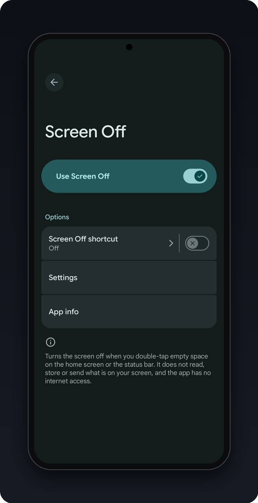
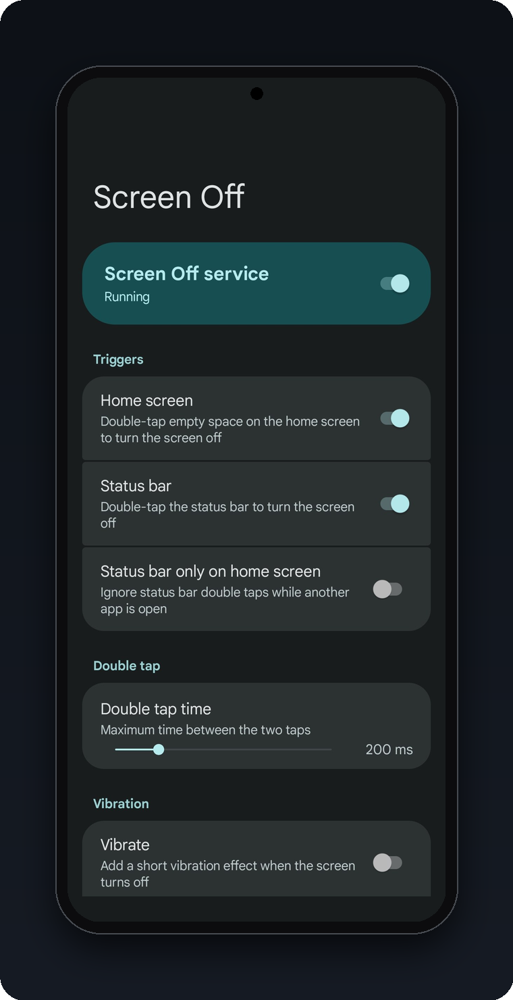
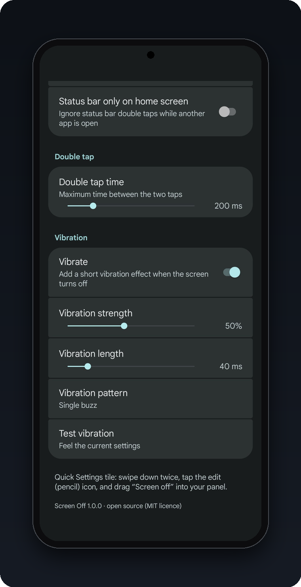
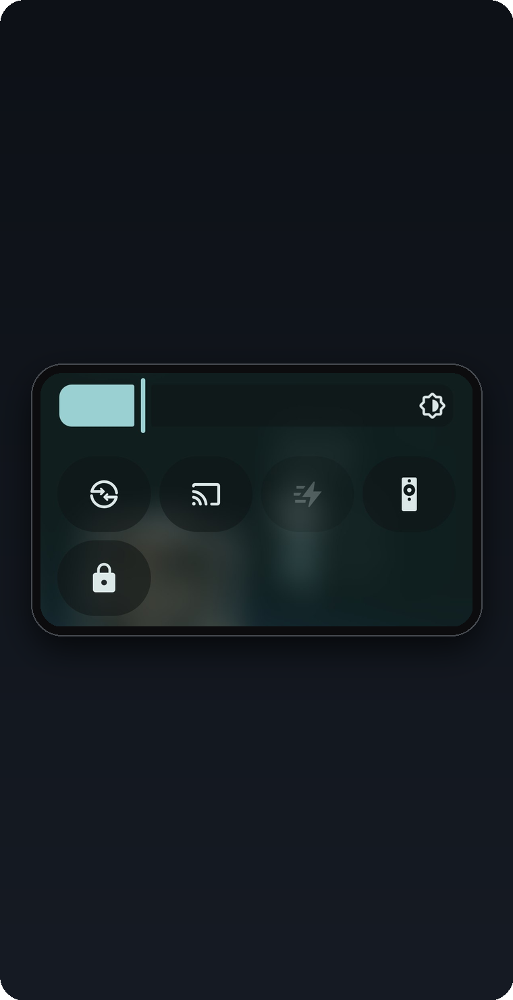

# Screen Off

**Double-tap to turn your Android screen off. No power button needed.**

Free · open source · no ads · no tracking · no internet · no root

## Features

- **Double-tap the home screen** on empty space to lock. Icons and widgets never trigger it.
- **Double-tap the status bar** to lock (by default only while on the home screen).
- **Quick Settings tile** for a one-tap lock.
- **Adjustable double-tap speed**, 100 to 600 ms.
- **Optional vibration** with strength, length and single/double pattern.
- **One simple settings screen**, with light/dark and Material You colours.
- **Private:** no internet permission, no analytics, nothing stored except your settings.
- **Light on battery:** negligible use, and it can save battery because the screen goes off instantly
  instead of waiting for the timeout.

Works on Android 11 and newer; developed on a Pixel 11 Pro running Android 17.

## Quick start

1. **Download** the latest `ScreenOff-x.y.z.apk` from [Releases](../../releases) and open it on your
   phone. **Play Protect will block it and offers no "Install anyway", so [pause Play Protect first](docs/INSTALL.md#pause-play-protect-to-install)** and turn it back on afterwards.
2. Go to **Settings > Accessibility > Screen Off** and switch it on. If the switch is greyed out, open
   **Settings > Apps > Screen Off**, tap the **⋮ menu > Allow restricted settings**, then try again.
3. Open any app and return to the home screen once.
4. **Double-tap** an empty spot on the home screen or the status bar. Done.

Settings live at *Accessibility > Screen Off > Settings* (the app has no launcher icon on purpose).
To add the tile: swipe down twice, tap the pencil, drag **Screen off** into the panel.

Full steps: [Install and set up](docs/INSTALL.md) · [Using it and settings](docs/USAGE.md)

## Good to know

- An accessibility service is a powerful permission. **Install only from this repository's
  [Releases](../../releases)** (check the SHA-256 in the notes) **or build it yourself.**
- It **cannot read your screen** (`canRetrieveWindowContent="false"`), has **no internet access**, and
  only asks for the `VIBRATE` permission.
- The home screen double tap is a heuristic, so a launcher that reports no taps could lock by mistake.
- Taps on status bar icons are swallowed while the status bar trigger is active.
- **Pause Play Protect to install**, then turn it back on. It blocks every new accessibility app from outside
  Google Play and gives no override button. This says nothing about this app in particular.
  [Why, and the steps](docs/INSTALL.md#pause-play-protect-to-install).
- Some banking apps dislike accessibility services. If one complains, switch Screen Off off while you use it.

## Documentation

| | |
|---|---|
| [Install and set up](docs/INSTALL.md) | APK, adb or source; turning it on; uninstalling |
| [Using it](docs/USAGE.md) | Gestures, every setting, troubleshooting |
| [Permissions, privacy and safety](docs/PRIVACY_AND_SAFETY.md) | What it can access, how to verify, limitations, battery |
| [How it works](docs/HOW_IT_WORKS.md) | The two double-tap detectors in detail |
| [Build from source](docs/BUILD.md) | Compile it, code layout, contributing |
| [Releasing](docs/RELEASING.md) | Signing and publishing a release |

Found a bug? [Open an issue](../../issues). Security problem? See [SECURITY.md](SECURITY.md).
Changes are listed in the [changelog](CHANGELOG.md).

## License

[MIT](LICENSE) © 2026 Shamik. Independent project, not affiliated with Google; "Pixel" and "Android" are
trademarks of Google LLC. Provided "as is", without warranty; use at your own risk.
